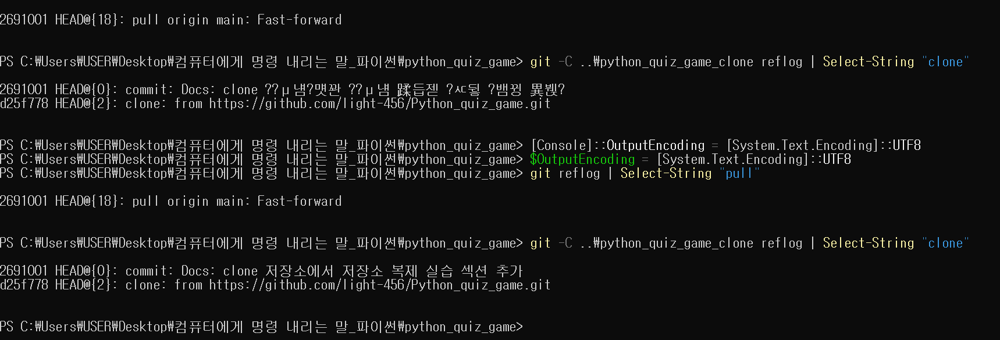
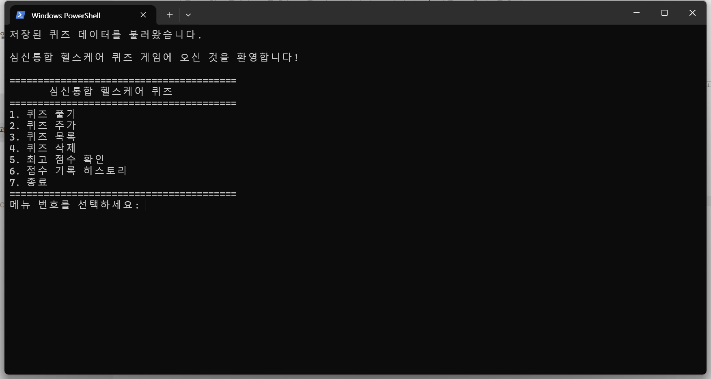
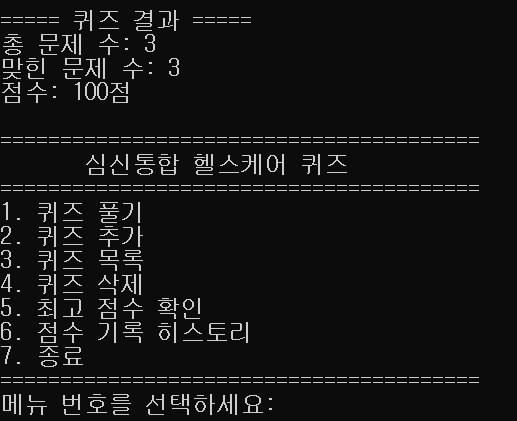
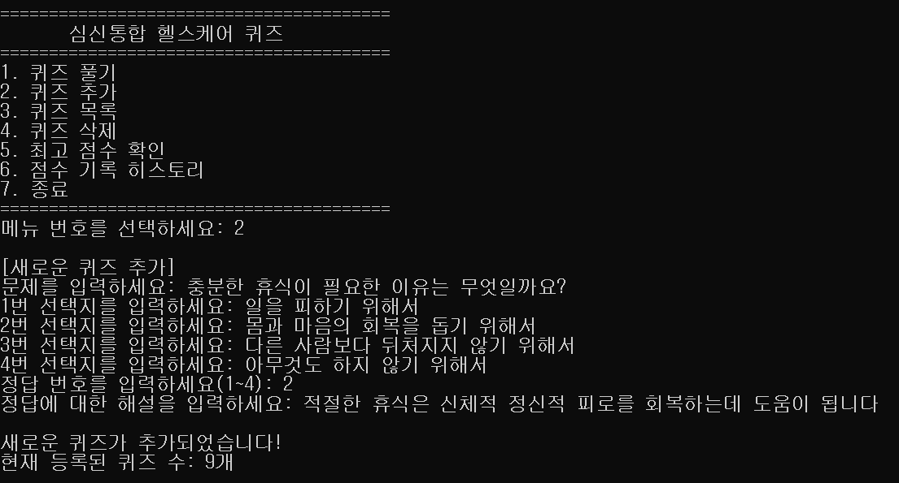
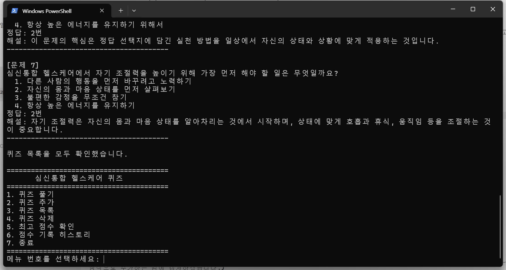
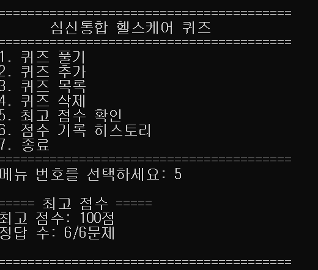
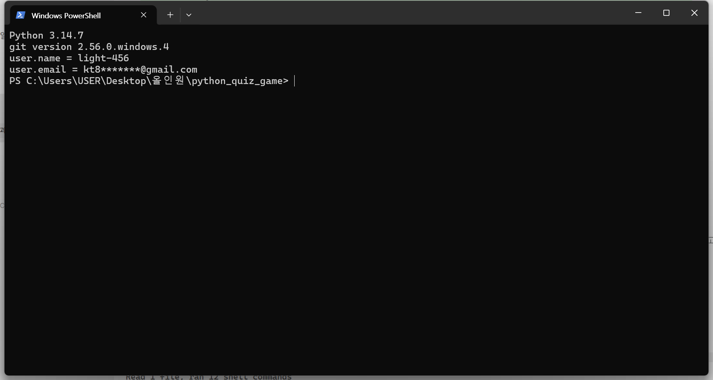
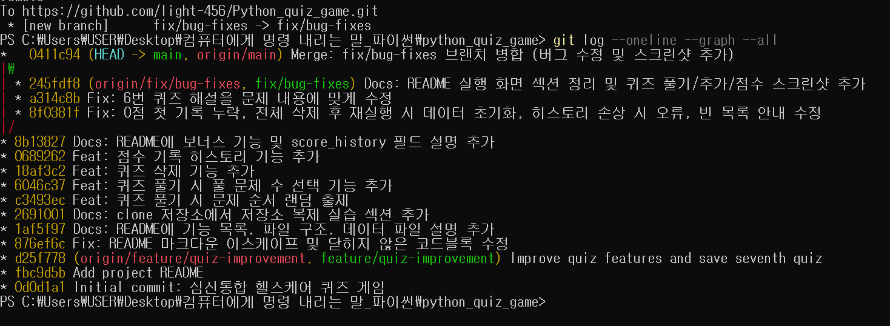

# 심신통합 헬스케어 퀴즈 게임

- GitHub 저장소: https://github.com/light-456/Python_quiz_game
- 개발 환경: Python 3.10 이상, 표준 라이브러리만 사용 (외부 라이브러리 없음)

## 목차

1. [프로젝트 개요](#1-프로젝트-개요)
2. [퀴즈 주제 선정 이유](#2-퀴즈-주제-선정-이유)
3. [실행 방법](#3-실행-방법)
4. [기능 목록](#4-기능-목록)
5. [파일 구조](#5-파일-구조)
6. [코드 구조와 설계](#6-코드-구조와-설계)
7. [데이터 파일 설명 (state.json)](#7-데이터-파일-설명-statejson)
8. [테스트 결과](#8-테스트-결과)
9. [Git 작업 기록](#9-git-작업-기록)
10. [요구사항 변경 시 수정 위치](#10-요구사항-변경-시-수정-위치)
11. [실행 화면](#11-실행-화면)

## 1. 프로젝트 개요

Python으로 개발한 콘솔 기반 퀴즈 게임입니다.

심신통합 헬스케어에 관한 지식을 퀴즈로 학습하고,
자신의 몸과 마음 상태를 알아차리는 습관의 중요성을 이해하도록 제작했습니다.

## 2. 퀴즈 주제 선정 이유

심신통합 헬스케어는 몸과 마음의 상태를 함께 살펴보고
자신에게 필요한 휴식과 활동을 적절하게 조절하는 데 도움을 주는 개념입니다.

이 주제를 통해 건강한 자기관리와 자기조절의 중요성을
쉽게 학습할 수 있도록 퀴즈 게임을 기획했습니다.

**기본 퀴즈 출처와 버전**
- 기본 퀴즈 5개는 스트레스 관리, 신체활동, 수면, 전문가 도움 등 일반적인 건강 생활 수칙을 바탕으로 직접 작성했습니다. 의학적 진단이나 치료를 대신하지 않는 학습용 문제입니다.
- 기본 퀴즈는 `main.py`의 `get_default_quizzes()`에 있고, 사용자가 추가한 퀴즈(6·7번)는 `state.json`에 저장됩니다.
- 변경 이력은 Git 커밋으로 관리합니다. (예: `a314c8b Fix: 6번 퀴즈 해설을 문제 내용에 맞게 수정`)

## 3. 실행 방법

1. Python 3.10 이상을 설치합니다.
2. 프로젝트 폴더로 이동합니다.
3. 다음 명령어를 실행합니다.

```bash
# Windows
py main.py

# macOS / Linux
python3 main.py
```

자동 테스트는 다음 명령어로 실행합니다. (결과는 [8. 테스트 결과](#8-테스트-결과) 참고)

```bash
# Windows
py -m unittest -v

# macOS / Linux
python3 -m unittest -v
```

## 4. 기능 목록

| 메뉴 | 기능 | 설명 | 담당 메서드 |
| --- | --- | --- | --- |
| 1 | 퀴즈 풀기 | 등록된 퀴즈를 **랜덤한 순서**로, **원하는 문제 수**만큼 출제하고, 정답 여부와 해설을 보여준 뒤 점수를 계산합니다. | `play_quiz()` |
| 2 | 퀴즈 추가 | 문제, 선택지 4개, 정답 번호, 해설을 입력받아 새 퀴즈를 등록하고 바로 저장합니다. | `add_quiz()` |
| 3 | 퀴즈 목록 | 등록된 모든 퀴즈의 문제/선택지/정답/해설을 확인합니다. | `show_quizzes()` |
| 4 | 퀴즈 삭제 | 번호를 선택해 등록된 퀴즈를 삭제하고 바로 저장합니다. | `delete_quiz()` |
| 5 | 최고 점수 확인 | 지금까지 기록된 최고 점수와 정답 수를 보여줍니다. | `show_high_score()` |
| 6 | 점수 기록 히스토리 | 지금까지 플레이한 모든 기록(날짜/시간, 정답 수, 점수)을 보여줍니다. | `show_score_history()` |
| 7 | 종료 | 데이터를 저장하고 프로그램을 안전하게 종료합니다. | `run()` |

**보너스 기능**
- 랜덤 출제: `random.shuffle`로 매번 문제 순서를 섞어서 출제합니다.
- 문제 수 선택: 퀴즈 풀기 시작 전에 몇 문제를 풀지 직접 선택할 수 있습니다.
- 퀴즈 삭제: 더 이상 필요 없는 퀴즈를 목록에서 제거하고 즉시 파일에 반영합니다.
- 점수 기록 히스토리: 매 플레이 결과(시간/정답 수/점수)를 누적 저장해 확인할 수 있습니다.

**예외 상황 처리**
- 퀴즈가 하나도 없으면 퀴즈 풀기와 목록에서 "등록된 퀴즈가 없습니다"를 안내합니다.
- 아직 퀴즈를 풀지 않았으면 "아직 기록된 점수가 없습니다"를 안내합니다.
- 첫 게임 점수가 0점이어도 최고 점수로 기록합니다.

### 4-1. 입력 처리 기준

숫자 입력은 모두 `get_number_input()`, 글자 입력은 모두 `get_nonempty_input()`이 처리합니다.
입력 앞뒤 공백은 `strip()`으로 제거한 뒤 검사합니다.

| 입력 예시 (메뉴 1~7 기준) | 결과 | 안내 메시지 |
| --- | --- | --- |
| `3` | ✅ 허용 | (3번 메뉴 실행) |
| ` 3 ` (앞뒤 공백) | ✅ 허용 | 공백을 제거하고 3으로 처리 |
| (그냥 Enter) | ❌ 다시 입력 | 숫자를 입력해 주세요. |
| `abc`, `1.5` | ❌ 다시 입력 | 숫자로 입력해 주세요. |
| `9`, `0`, `-1` | ❌ 다시 입력 | 1~7 사이의 번호를 입력하세요. |
| 퀴즈 추가 시 빈 문제/선택지/해설 | ❌ 다시 입력 | 내용을 비워둘 수 없습니다. 다시 입력해 주세요. |

정답 번호(1~4), 풀 문제 수(1~전체 문제 수), 삭제할 번호(1~퀴즈 수)도 같은 기준을 범위만 바꿔서 사용합니다.

### 4-2. 중단(Ctrl+C / 입력 종료) 시 동작

| 중단 시점 | 동작 |
| --- | --- |
| 데이터 불러오는 중 | "프로그램 시작이 중단되었습니다. 안전하게 종료합니다." 출력 후 종료 |
| 메뉴 선택 중 | "입력이 중단되었습니다." 출력 → 현재 데이터 저장 → 종료 |
| 퀴즈 풀기 도중 | 이미 저장된 데이터는 그대로 두고, 끝나지 않은 게임은 점수에 반영하지 않고 저장 후 종료 |
| 퀴즈 추가 도중 | 입력이 끝나지 않은 퀴즈는 추가하지 않고, 기존 데이터 저장 후 종료 |

어떤 경우에도 오류 메시지(Traceback)를 띄우며 비정상 종료하지 않습니다.

## 5. 파일 구조

```
python_quiz_game/
├── main.py            # Quiz, QuizGame 클래스와 게임 실행 로직
├── test_main.py       # unittest 자동 테스트 (실제 state.json은 건드리지 않음)
├── state.json         # 퀴즈 목록, 최고 점수, 점수 기록을 저장하는 데이터 파일
├── README.md          # 프로젝트 설명 문서 (이 파일)
├── .gitignore         # __pycache__, *.pyc, main_backup.py, state.json.bak 추적 제외
└── docs/
    └── screenshots/   # 실행 화면, 개발 환경, Git 기록 캡처 이미지
```

`state.json.bak`은 저장 파일이 손상되었을 때만 자동으로 생기는 백업 파일이라 Git에 올리지 않습니다.

## 6. 코드 구조와 설계

### 6-1. 클래스별 역할

| 클래스 | 책임 | 주요 속성 | 주요 메서드 |
| --- | --- | --- | --- |
| `Quiz` | 퀴즈 **한 문제**의 데이터 | `question`, `choices`, `answer`, `explanation` | `to_dict()`: 저장용 딕셔너리로 변환 |
| `QuizGame` | 게임 **전체** 진행과 데이터 관리 | `quizzes`(Quiz 목록), `high_score`, `high_score_correct`, `high_score_total`, `score_history` | 아래 표 참고 |

`QuizGame`은 여러 개의 `Quiz` 객체를 `self.quizzes` 리스트로 가지고 있고(포함 관계),
저장할 때는 각 `Quiz`의 `to_dict()`를 호출해 JSON으로 바꿉니다.
불러올 때는 반대로 JSON의 각 항목을 검사한 뒤 `Quiz(...)` 객체로 다시 만듭니다.

### 6-2. 역할별 메서드 분리

| 역할 | 메서드 | 이렇게 나눈 이유 |
| --- | --- | --- |
| 입력 검증 | `get_number_input()`, `get_nonempty_input()` | 메뉴·정답·문제 수·삭제 번호 등 모든 입력이 같은 규칙을 쓰도록 한 곳에 모음 |
| 게임 진행 | `play_quiz()`, `add_quiz()`, `show_quizzes()`, `delete_quiz()`, `show_high_score()`, `show_score_history()` | 메뉴 1개 = 메서드 1개로 연결해 기능을 찾기 쉽게 함 |
| 데이터 입출력 | `load_state()`, `save_state()`, `backup_broken_file()` | 파일 형식이 바뀌어도 이 세 메서드만 고치면 되도록 분리 |
| 화면/흐름 | `show_menu()`, `run()` | 메뉴 반복과 중단 처리를 한 곳에서 관리 |

입력 검증과 데이터 입출력을 게임 로직과 분리했기 때문에, 예를 들어 저장 방식을 바꿔도
`play_quiz()` 같은 게임 기능은 수정할 필요가 없습니다.

### 6-3. 클래스(객체 지향)를 사용한 이유

- **상태를 한 곳에서 관리**: 퀴즈 목록, 최고 점수, 점수 기록은 여러 기능이 함께 쓰는 데이터입니다.
  함수만으로 만들면 이 값들을 전역 변수로 두거나 모든 함수에 매개변수로 넘겨야 하지만,
  클래스를 쓰면 `self.quizzes`, `self.high_score`처럼 객체 안에 묶어 두고 모든 메서드가 함께 사용할 수 있습니다.
- **데이터와 동작을 함께 묶음**: 퀴즈 한 문제의 정보와 그 정보를 저장 형식으로 바꾸는 동작(`to_dict`)이
  `Quiz` 클래스 안에 함께 있어서 퀴즈 구조가 바뀌면 `Quiz`만 고치면 됩니다.
- **테스트하기 쉬움**: `QuizGame()` 객체를 새로 만들면 항상 같은 초기 상태에서 시작하므로
  `test_main.py`에서 기능별로 독립적인 테스트를 만들 수 있었습니다.

## 7. 데이터 파일 설명 (state.json)

프로그램 실행 중 추가한 퀴즈와 최고 점수는 프로젝트 루트의 `state.json`에
UTF-8 인코딩으로 저장됩니다. 프로그램을 종료했다가 다시 실행해도 이 파일을
읽어와 이전 상태를 그대로 이어갑니다.

```json
{
    "quizzes": [
        {
            "question": "문제 내용",
            "choices": ["선택지1", "선택지2", "선택지3", "선택지4"],
            "answer": 1,
            "explanation": "정답에 대한 해설"
        }
    ],
    "high_score": 80,
    "high_score_correct": 4,
    "high_score_total": 5,
    "score_history": [
        {
            "timestamp": "2026-11-09 19:00",
            "correct": 4,
            "total": 5,
            "percentage": 80
        }
    ]
}
```

| 필드 | 형식 | 설명 |
| --- | --- | --- |
| `quizzes` | list | 등록된 퀴즈 목록. 각 퀴즈는 문제(`question`), 선택지 4개(`choices`), 정답 번호 1~4(`answer`), 해설(`explanation`)을 가집니다. |
| `high_score` | int | 최고 점수(백분율, 0~100) |
| `high_score_correct` / `high_score_total` | int | 최고 점수를 냈을 때의 정답 수 / 전체 문제 수 |
| `score_history` | list | 매 플레이 기록. 시각(`timestamp`), 정답 수(`correct`), 전체 문제 수(`total`), 점수(`percentage`) |

### 7-1. 언제 읽고 저장하나요?

```
프로그램 시작 → load_state()
   ├─ 파일 없음 → 기본 퀴즈 5개 사용 → save_state()로 새 파일 생성
   └─ 파일 있음 → 읽기 → 형식 검증 → 올바른 퀴즈만 Quiz 객체로 복원 → save_state()
         └─ 손상됨 → 안내 메시지 → state.json.bak으로 백업 → 기본 데이터로 복구 → save_state()

퀴즈 풀기 완료 / 퀴즈 추가 / 퀴즈 삭제 / 프로그램 종료 → save_state()
```

- 파일 위치는 `DATA_FILE = Path(__file__).with_name("state.json")`이라서
  어느 폴더에서 실행해도 항상 `main.py`와 같은 폴더의 `state.json`을 사용합니다.
- 검증 항목: 최상위가 딕셔너리인지, `quizzes`가 리스트인지, 각 퀴즈의 문제가 빈 문자열이 아닌지,
  선택지가 정확히 4개인 문자열 리스트인지, 정답이 1~4 정수인지 확인합니다.
  잘못된 퀴즈 항목만 건너뛰고, 나머지는 정상적으로 불러옵니다.
- 사용자가 퀴즈를 전부 삭제해서 생긴 빈 목록은 손상으로 보지 않습니다.

### 7-2. 오류 처리와 안내 메시지

| 상황 | 처리하는 예외 | 사용자 안내 |
| --- | --- | --- |
| JSON 문법이 깨짐, 형식이 다름 | `json.JSONDecodeError`, `ValueError`, `TypeError`, `KeyError` | "저장 파일이 손상되었거나 올바르지 않습니다." → "기존 파일은 state.json.bak에 백업했습니다." → "기본 퀴즈 데이터로 다시 시작합니다." |
| 파일 읽기 실패 (권한 등) | `OSError` | 위와 같음 |
| 파일 쓰기 실패 | `OSError` | "데이터 저장에 실패했습니다: (오류 내용)" — 프로그램은 계속 실행 |

- 손상된 파일은 덮어쓰기 전에 **`state.json.bak`으로 복사**해 두기 때문에, 직접 열어서 내용을 확인하거나
  고친 뒤 이름을 `state.json`으로 바꾸면 이전 데이터를 되살릴 수 있습니다.
- 별도의 로그 파일은 만들지 않고, 모든 안내는 콘솔 화면에 출력합니다.

### 7-3. JSON을 사용한 이유

- **사람이 읽고 고칠 수 있음**: 메모장으로 열어도 내용을 바로 이해할 수 있습니다. (`ensure_ascii=False`, `indent=4`로 한글과 들여쓰기 유지)
- **Python 자료형과 바로 대응**: JSON의 객체/배열/숫자/문자열이 Python의 `dict`/`list`/`int`/`str`과 같아서 `json` 표준 모듈만으로 저장·복원할 수 있습니다.
- **중첩 구조 표현**: 선택지는 항상 4개가 한 묶음이므로 `choices` 배열로 묶었고, 퀴즈와 점수 기록은 각각 객체의 배열로 만들었습니다.
  이렇게 하면 퀴즈에 `hint` 같은 새 항목이 생겨도 키 하나만 추가하면 되고, 기존 데이터와도 호환됩니다.

### 7-4. JSON 저장 방식의 한계와 대안

| 한계 | 설명 | 대안 |
| --- | --- | --- |
| 전체를 매번 다시 씀 | 퀴즈 하나만 바뀌어도 파일 전체를 읽고 씁니다. 퀴즈가 수천 개 이상이면 느려지고 메모리를 많이 씁니다. | 표준 라이브러리 `sqlite3`(SQLite)로 바꾸면 바뀐 행만 저장할 수 있습니다. |
| 동시 실행에 약함 | 프로그램을 두 개 동시에 실행하면 나중에 저장한 쪽이 앞의 변경을 덮어씁니다. 파일 잠금 기능은 없습니다. | **한 번에 하나만 실행**해야 합니다. 여러 명이 쓴다면 SQLite나 서버 DB를 사용합니다. |
| 저장 도중 꺼짐 | 쓰는 도중 전원이 꺼지면 파일이 손상될 수 있습니다. | 손상 시 `state.json.bak` 백업 후 기본 데이터로 복구합니다. 더 안전하게 하려면 임시 파일에 쓴 뒤 이름을 바꾸는 방식을 쓸 수 있습니다. |
| 검색 기능 없음 | 특정 퀴즈를 찾으려면 리스트 전체를 확인해야 합니다. | 데이터가 많아지면 DB의 검색(SQL) 기능을 사용합니다. |

이 프로젝트는 퀴즈가 수십 개 수준인 개인용 학습 게임이라 JSON으로 충분하다고 판단했습니다.

## 8. 테스트 결과

### 8-1. 자동 테스트 (`test_main.py`)

`py -m unittest -v`로 실행하며, 임시 폴더의 파일만 사용하므로 실제 `state.json`은 바뀌지 않습니다.

| 테스트 | 확인 내용 |
| --- | --- |
| `test_to_dict` | Quiz 객체가 올바른 딕셔너리로 변환되는지 |
| `test_number_input_retries_until_valid` | 빈 입력, `abc`, `9`, `0` 입력 후 다시 묻고 ` 3 `은 3으로 받는지 |
| `test_nonempty_input_rejects_blank` | 공백만 입력하면 다시 묻는지 |
| `test_first_run_uses_default_quizzes` | 파일이 없을 때 기본 퀴즈 5개로 시작하고 파일을 만드는지 |
| `test_corrupted_file_is_backed_up_and_reset` | 손상된 파일을 백업하고 기본 데이터로 복구하는지 |
| `test_saved_data_survives_restart` | 추가한 퀴즈가 재시작 후에도 남아 있는지 |
| `test_empty_quiz_list_is_not_treated_as_corrupted` | 퀴즈를 전부 삭제해도 최고 점수가 유지되는지 |
| `test_play_updates_high_score_and_history` | 전부 맞히면 100점, 최고 점수와 히스토리가 저장되는지 |
| `test_zero_score_is_recorded_as_first_score` | 첫 게임 0점도 기록되는지 |
| `test_no_quizzes` | 퀴즈가 없을 때 풀기/목록에서 안내하는지 |
| `test_no_score_yet` | 아직 풀지 않았을 때 안내하는지 |
| `test_delete_quiz_is_saved` | 삭제 결과가 파일에 반영되는지 |
| `test_ctrl_c_and_eof_exit_safely` | Ctrl+C와 입력 종료 시 오류 없이 저장 후 종료하는지 |

```
Ran 13 tests

OK
```

### 8-2. 메뉴 흐름 직접 실행 확인

| 순서 | 입력 | 확인한 결과 |
| --- | --- | --- |
| 1 | `1` → 문제 수 `2` → 정답 입력 | 문제 2개 랜덤 출제, 정답/오답과 해설 표시, 결과 점수 출력 |
| 2 | `2` → 문제·선택지 4개·정답·해설 입력 | "새로운 퀴즈가 추가되었습니다!" 출력, 퀴즈 수 증가 |
| 3 | `3` | 전체 퀴즈와 정답·해설 목록 출력 |
| 4 | `4` → 번호 입력 | 선택한 퀴즈 삭제, 퀴즈 수 감소 |
| 5 | `5` | 최고 점수와 정답 수 출력 |
| 6 | `6` | 플레이 기록(시각, 정답 수, 점수) 출력 |
| 7 | `7` | "데이터 저장을 확인했습니다." 출력 후 종료 |
| 8 | 프로그램 재실행 | "저장된 퀴즈 데이터를 불러왔습니다." 출력, 추가한 퀴즈와 최고 점수 유지 |

## 9. Git 작업 기록

### 9-1. 커밋 기록 (`git log --oneline --graph --all`)

아래는 README의 이 섹션을 작성한 시점의 기록입니다. (커밋 16개, 이후 커밋은 GitHub에서 확인할 수 있습니다.)

```
* b401234 Docs: 브랜치 병합이 반영된 git log 그래프 스크린샷으로 교체
*   0411c94 Merge: fix/bug-fixes 브랜치 병합 (버그 수정 및 스크린샷 추가)
|\
| * 245fdf8 Docs: README 실행 화면 섹션 정리 및 퀴즈 풀기/추가/점수 스크린샷 추가
| * a314c8b Fix: 6번 퀴즈 해설을 문제 내용에 맞게 수정
| * 8f0381f Fix: 0점 첫 기록 누락, 전체 삭제 후 재실행 시 데이터 초기화, 히스토리 손상 시 오류, 빈 목록 안내 수정
|/
* 8b13827 Docs: README에 보너스 기능 및 score_history 필드 설명 추가
* 0689262 Feat: 점수 기록 히스토리 기능 추가
* 18af3c2 Feat: 퀴즈 삭제 기능 추가
* 6046c37 Feat: 퀴즈 풀기 시 풀 문제 수 선택 기능 추가
* c3493ec Feat: 퀴즈 풀기 시 문제 순서 랜덤 출제
* 2691001 Docs: clone 저장소에서 저장소 복제 실습 섹션 추가
* 1af5f97 Docs: README에 기능 목록, 파일 구조, 데이터 파일 설명 추가
* 876ef6c Fix: README 마크다운 이스케이프 및 닫히지 않은 코드블록 수정
* d25f778 Improve quiz features and save seventh quiz
* fbc9d5b Add project README
* 0d0d1a1 Initial commit: 심신통합 헬스케어 퀴즈 게임
```

### 9-2. 사용한 Git 명령어

| 명령어 | 한 일 | 기록 |
| --- | --- | --- |
| `git init` | 로컬 폴더를 Git 저장소로 만들기 | `0d0d1a1 Initial commit` |
| `git add` / `git commit` | 기능 단위로 변경 사항 기록 | 위 커밋 16개 |
| `git push` | 로컬 커밋을 GitHub에 업로드 | `origin/main`, `origin/fix/bug-fixes` |
| `git checkout -b` | 작업용 브랜치 만들기 | `feature/quiz-improvement`, `fix/bug-fixes` |
| `git merge` | 브랜치 작업을 main에 합치기 | `0411c94 Merge: fix/bug-fixes 브랜치 병합` |
| `git clone` | 저장소를 다른 폴더에 복제 | `python_quiz_game_clone` 폴더 |
| `git pull` | 원격 변경 사항을 원래 폴더로 가져오기 | `2691001` 커밋을 원래 폴더로 받음 |

### 9-3. 브랜치 전략과 병합 기록

| 브랜치 | 용도 | 병합 방식 |
| --- | --- | --- |
| `main` | 항상 실행 가능한 완성본만 유지 | — |
| `feature/quiz-improvement` | 해설 기능 추가와 7번째 퀴즈 저장 (`d25f778`) | fast-forward 병합 (병합 커밋 없이 main이 앞으로 이동) |
| `fix/bug-fixes` | 테스트로 찾은 버그 4개 수정, 퀴즈 해설 수정, 스크린샷 추가 | `--no-ff` 병합 → 병합 커밋 `0411c94` |

**브랜치를 나누는 이유와 병합 기준**
- 새 기능(`feature/…`), 버그 수정(`fix/…`), 문서 작업(`docs/…`)은 main이 아닌 별도 브랜치에서 작업합니다.
  작업 중에 코드가 잠시 동작하지 않더라도 main은 항상 실행 가능한 상태로 남습니다.
- 브랜치에서 **프로그램 실행과 자동 테스트(`py -m unittest`)가 모두 통과**한 뒤에만 main에 병합합니다.
- 병합할 때는 `git merge --no-ff`를 사용해 병합 커밋을 남깁니다. 그래야 `git log --graph`에서
  어떤 커밋들이 한 브랜치에서 함께 작업되었는지 보입니다.
- 병합한 브랜치는 기록 확인을 위해 GitHub에 그대로 남겨 둡니다.

### 9-4. 커밋 규칙

**커밋 단위**: 하나의 커밋에는 하나의 목적(기능 하나, 버그 수정 하나, 문서 하나)만 담습니다.
코드 변경과 문서 변경은 가능한 한 다른 커밋으로 나눕니다.

**메시지 형식**: `타입: 변경 내용 요약`

| 타입 | 언제 쓰나요 | 이 저장소의 예시 |
| --- | --- | --- |
| `Feat` | 새 기능 추가 | `c3493ec Feat: 퀴즈 풀기 시 문제 순서 랜덤 출제` |
| `Fix` | 버그나 잘못된 내용 수정 | `8f0381f Fix: 0점 첫 기록 누락, … 수정` |
| `Docs` | README 등 문서 수정 | `1af5f97 Docs: README에 기능 목록, 파일 구조, 데이터 파일 설명 추가` |
| `Test` | 테스트 코드 추가·수정 | `Test: unittest 자동 테스트 추가` |
| `Refactor` | 동작은 같고 구조만 개선 | `Refactor: QuizGame 책임 분리` |
| `Merge` | 브랜치 병합 | `0411c94 Merge: fix/bug-fixes 브랜치 병합 …` |

초기 커밋 두 개(`fbc9d5b`, `d25f778`)는 이 규칙을 정하기 전에 작성해서 형식이 다릅니다.

### 9-5. clone / pull 실습

1. 원래 작업 폴더(`python_quiz_game`)와 별도로 저장소를 복제했습니다.
   ```bash
   git clone https://github.com/light-456/Python_quiz_game.git python_quiz_game_clone
   ```
2. 복제한 폴더(`python_quiz_game_clone`)에서 README에 clone 실습 섹션을 추가하고 커밋·푸시했습니다.
   ```bash
   git add README.md
   git commit -m "Docs: clone 저장소에서 저장소 복제 실습 섹션 추가"
   git push origin main
   ```
3. 원래 작업 폴더로 돌아와서 변경 사항을 받아왔습니다.
   ```bash
   git pull origin main
   ```
4. 원래 폴더의 `git log`에 clone 폴더에서 만든 `2691001` 커밋이 나타나고, README에 이 섹션이 추가된 것을 확인했습니다.
   이후 커밋(`c3493ec` 등)은 모두 이 커밋 위에 이어서 작성되었습니다.

**실행 기록 (`git reflog`)**

clone 폴더(`python_quiz_game_clone`) — 복제(`d25f778` 시점)한 뒤 `2691001` 커밋을 만들었습니다.

```
PS ...\python_quiz_game> git -C ..\python_quiz_game_clone reflog | Select-String "clone"
2691001 HEAD@{0}: commit: Docs: clone 저장소에서 저장소 복제 실습 섹션 추가
d25f778 HEAD@{2}: clone: from https://github.com/light-456/Python_quiz_game.git
```

원래 폴더(`python_quiz_game`) — clone 폴더에서 올린 `2691001` 커밋을 pull로 받아왔습니다.

```
PS ...\python_quiz_game> git reflog | Select-String "pull"
2691001 HEAD@{15}: pull origin main: Fast-forward
```



## 10. 요구사항 변경 시 수정 위치

| 바꾸고 싶은 것 | 수정할 파일 | 수정할 메서드/위치 |
| --- | --- | --- |
| 기본 퀴즈 내용 | `main.py` | `QuizGame.get_default_quizzes()` |
| 퀴즈에 새 항목 추가 (예: 힌트) | `main.py`, `README.md` | `Quiz.__init__()`, `Quiz.to_dict()`, `load_state()`의 검증 조건, `add_quiz()`, `play_quiz()` / README 7장 스키마 |
| 선택지 개수 변경 (4개 → 5개) | `main.py` | `load_state()`의 `len(choices) == 4`, `add_quiz()`의 `range(1, 5)`, 정답 입력 범위 `1, 4` |
| 점수 계산 방식 | `main.py` | `play_quiz()`의 `percentage` 계산과 최고 점수 비교 부분 |
| 메뉴 추가·순서 변경 | `main.py` | `show_menu()`, `run()`의 `if/elif`와 입력 범위 `1, 7` |
| 입력 안내 문구·검증 규칙 | `main.py` | `get_number_input()`, `get_nonempty_input()` |
| 저장 파일 이름·위치 | `main.py` | 맨 위의 `DATA_FILE`, `BACKUP_FILE` |
| 저장 방식 변경 (예: SQLite) | `main.py` | `load_state()`, `save_state()`, `backup_broken_file()`만 교체 |

기능을 바꾼 뒤에는 `py -m unittest -v`로 기존 기능이 그대로 동작하는지 확인하고,
`test_main.py`에 새 기능의 테스트를 추가합니다.

## 11. 실행 화면

| 메뉴 | 퀴즈 풀기 |
| --- | --- |
|  |  |

| 퀴즈 추가 | 퀴즈 목록 |
| --- | --- |
|  |  |

| 최고 점수 확인 |
| --- |
|  |

### 개발 환경 및 Git 기록

| 개발 환경 | Git 기록 (`git log --oneline --graph`) |
| --- | --- |
|  |  |
